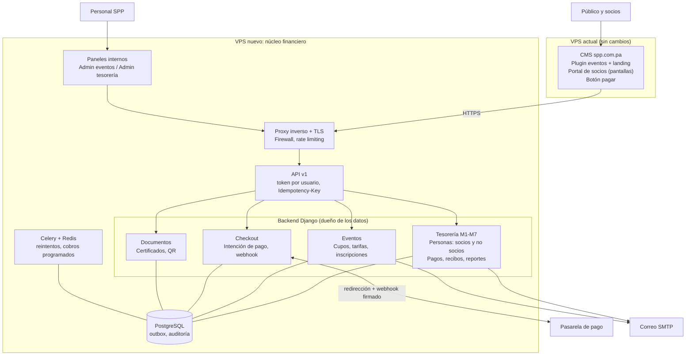
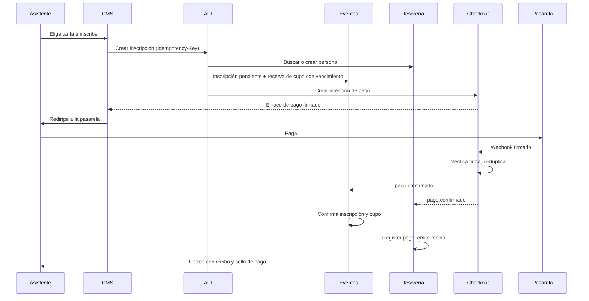

# Sistema integral de Eventos, Tesorería y Portal de Socios — SPP

Documento de arquitectura. Une la propuesta comercial de Innovate (INPA-DOC-003, 15-abr-2026) con el plan de ecosistema (Eventos + Checkout + Tesorería + Portal). Estado: decisiones de arquitectura cerradas, pendientes listados en la sección 13.

## 1. Objetivo

Unificar en un solo ecosistema la emisión de comprobantes, los cobros recurrentes, el registro multicanal de ingresos, la inscripción a eventos y el autoservicio de socios, con trazabilidad en cada transacción. Cada módulo expone una API estandarizada para integrarse con sistemas presentes o futuros (contabilidad, pasarelas, CRM, app móvil).

## 2. Decisiones tomadas

| # | Decisión | Motivo |
|---|---|---|
| 1 | El CMS propio (PHP) en `spp.com.pa` es el frontal: landing de eventos, portal de socios y botón de pago. No guarda datos financieros ni de personas. | Un solo sitio para el usuario, sin duplicar contenido. |
| 2 | El backend es una aplicación aparte, en un VPS nuevo, separado del CMS. | Aislamiento: un fallo o intrusión en el CMS no alcanza pagos ni datos fiscales. |
| 3 | Tesorería es dueña de la base de personas (socios y no socios). | Un solo registro por persona; Eventos solo guarda el identificador. |
| 4 | Stack backend: Django + Django REST Framework, PostgreSQL, Celery + Redis. | El equipo domina Python/Django, y la seguridad es la prioridad. |
| 5 | Los datos de tarjeta nunca tocan el CMS ni el backend: se paga en la página de la pasarela. | Reduce el alcance de cumplimiento y el riesgo. |
| 6 | Checkout solo confirma el pago y publica `pago.confirmado`; Eventos y Tesorería lo consumen por separado. | Un fallo al emitir el recibo no quita el cupo al asistente. |
| 7 | La API manda: valida identidad y permisos en cada llamada; el CMS no es de confianza. | Un CMS comprometido no debe dar acceso a todos los socios. |

## 3. Arquitectura general

## 4. Dominios y servidores

| Dominio | Contenido | Servidor |
|---|---|---|
| `spp.com.pa` / `www` | CMS institucional, landing de eventos, portal de socios | VPS actual |
| `api.spp.com.pa` | API v1 (la usa el CMS, los paneles y los sistemas externos) | VPS nuevo |
| `pagos.spp.com.pa` | Página de inicio del pago y retorno desde la pasarela | VPS nuevo |
| `verificar.spp.com.pa` | Verificación pública de certificados (solo lectura) | VPS nuevo |

El DNS lo administra la SPP. Desaparecen los subdominios `eventos.` y `portal.` previstos antes, porque esas funciones viven en el CMS.

**Hosting.** El VPS nuevo corre Nginx, Gunicorn, PostgreSQL y Redis. La base de datos y Redis solo aceptan conexiones desde la red privada. Respaldos automáticos y cifrados, con restauración probada.

## 5. Módulos

### Propuesta de Innovate

| Módulo | Proceso | Servicios de la API |
|---|---|---|
| M1 Identidad y acceso | Valida credenciales, asigna sesión por perfil, bloquea lo no permitido | Validación de credenciales; consulta de perfil; cierre y renovación de sesión |
| M2 Maestro de socios y cuentas | Mantiene el expediente de cada persona y su balance en tiempo real | Registro y actualización; consulta de cartera; estado de cuenta |
| M3 Emisión, recurrencia y facturación | Comprobantes con numeración correlativa, impuestos y calendarios de cobro | Emisión; consulta y búsqueda; programación de recurrencias; anulación con motivo |
| M4 Tesorería y pasarela | Cobros manuales y automáticos; concilia la deuda al acreditarse el pago | Pago presencial; enlace de pago; receptor de notificaciones de cobro; historial de transacciones |
| M5 Comprobantes visuales | Recibo como imagen para móvil y documento descargable | Renderizado; regeneración de plantilla (sello Pagado/Cancelado) |
| M6 Notificaciones | Correos: nuevo recibo, recordatorio, acuse de pago | Despacho de comprobante; notificación de cobro exitoso; recordatorios masivos |
| M7 Inteligencia financiera | KPIs, mora por antigüedad (30/60/90+), flujo de caja | KPIs; antigüedad de deuda; flujo de caja |

### Añadidos del plan de ecosistema

| Módulo | Responsabilidad |
|---|---|
| Eventos | Eventos, sesiones, categorías y tarifas con vigencia, cupos con reserva y vencimiento, inscripciones, check-in, solicitud de certificado |
| Checkout | Intención de pago, comunicación con la pasarela, webhooks firmados, reembolsos, outbox |
| Documentos | Plantillas versionadas, certificados, hash/QR, verificación pública, revocación |
| Auditoría (transversal) | Registro de solo inserción de cada acción sensible |

## 6. Perfiles de acceso

| Perfil | Qué hace | Accede a |
|---|---|---|
| Administración del sistema | Supervisión del entorno, respaldos, accesos e integraciones | M1, auditoría, configuración |
| Gerencia | Supervisión financiera, datos fiscales y reglas de negocio, consulta de reportes | M7, parámetros, vista de M4 |
| Operador | Emite comprobantes, programa cobros, registra pagos presenciales, atiende socios | M2, M3, M4 |
| Socio / cliente final | Estado de cuenta, comprobantes, descarga de recibos, pago electrónico | Portal en el CMS (vía API) |

## 7. Propiedad de los datos

| Dato | Dueño | Observación |
|---|---|---|
| Header, footer, navegación, páginas institucionales, legales | CMS | |
| Texto, tarifas, cupos y fechas de cada evento | Eventos | El CMS solo lee por API, con caché de respaldo |
| Personas: socios y no socios, datos fiscales | Tesorería | Una sola tabla; la condición (socio, exsocio, no socio) es un atributo |
| Inscripción y check-in | Eventos | Referencia a la persona por identificador |
| Intención de pago y estado ante la pasarela | Checkout | |
| Pagos, libro contable, recibos, estado de cuenta | Tesorería | El estado de cuenta se deriva del libro |
| Certificados y plantillas | Documentos | |

## 8. Flujo de inscripción y pago

**Pagos manuales** (efectivo, transferencia, Yappy, ACH): el operador los registra en Tesorería con comprobante adjunto, un segundo usuario los aprueba, y se emite el mismo evento `pago.confirmado`.

**Conciliación diaria:** compara pasarela, Checkout, Eventos y Tesorería, y señala diferencias.

## 9. Modelo de datos conceptual

- **Tesorería:** Persona (socio/no socio), dato fiscal, pago (online o manual), movimiento contable (libro), recibo/factura, nota de crédito, regla de recurrencia, partida de conciliación.
- **Eventos:** evento, sesión, categoría de participante, tarifa (categoría + vigencia + precio), inscripción (estado, canal), reserva de cupo, check-in, solicitud de certificado.
- **Checkout:** intención de pago, intento, registro de eventos de pasarela, reembolso, outbox.
- **Documentos:** plantilla versionada, certificado, verificación, revocación.
- **Transversal:** usuario, rol, auditoría (solo inserción).

**Estados.** Inscripción: pendiente de pago → pagada → cancelada o reembolsada; salidas: pago fallido, expirada. Pago: recibido → recibo emitido → conciliado; con error de emisión reintentable y anulado o reembolsado.

## 10. Stack

| Capa | Tecnología |
|---|---|
| Backend | Django + Django REST Framework |
| Base de datos | PostgreSQL |
| Tareas y cobros programados | Celery + Redis |
| Paneles internos | Django admin con permisos por perfil |
| Autenticación de API | Tokens de corta duración por usuario; credencial separada por servicio |
| Servidor | Nginx + Gunicorn |
| Contrato de API | OpenAPI generado y validado en CI |
| Recibos | Generación de PDF e imagen en el backend |
| Dinero | `Decimal` exacto, nunca flotantes |

## 11. Seguridad

**Accesos**
- 2FA obligatorio para administración, gerencia y operador.
- Bloqueo por intentos fallidos y límite de peticiones en la API.
- Panel de administración solo por VPN o lista de IPs.
- Permisos por objeto en el backend: cada socio solo ve lo suyo.
- El CMS usa credenciales de mínimo privilegio: lectura de eventos y creación de inscripciones; no emite recibos ni anula pagos.

**Datos**
- Ningún dato de tarjeta pasa por el CMS ni el backend.
- Cifrado de campos sensibles (cédula, datos fiscales) y de los respaldos.
- El usuario de base de datos de la app solo puede insertar en las tablas del libro contable y de auditoría. Las anulaciones son asientos de reverso.

**Pagos**
- Webhook con firma verificada y deduplicación.
- `Idempotency-Key` obligatorio en toda escritura.
- Enlaces de pago firmados, con vencimiento y concepto obligatorio.

**Operación**
- TLS en todo, HSTS, CSP y cookies seguras.
- Secretos fuera del código.
- Escaneo de dependencias y parches de seguridad en el CI.
- Auditoría de cada acción sensible: quién, qué, cuándo y desde dónde.
- Pruebas automatizadas de permisos entre socios.
- Prueba de penetración externa antes de abrir el portal.

**Datos personales.** Minimizar lo que se guarda, definir consentimiento y plazo de conservación para no socios, conforme a la ley panameña de protección de datos.

## 12. Fases

| Fase | Contenido | Aceptación |
|---|---|---|
| M · 30-oct-2026 | Landing en el CMS con tarifas, formas de pago, Grand Tours y contacto. El formulario deja de simular y guarda las solicitudes de verdad. | Ninguna solicitud se pierde; sin textos de ejemplo. |
| 0 · Descubrimiento | Respuestas a la sección 13; OpenAPI v0; modelo de datos revisado por contabilidad. | Documento de decisiones firmado por la SPP. |
| 1 · Fundaciones | VPS nuevo, CI/CD, ambientes, PostgreSQL, M1, auditoría, 2FA, usuario de solo inserción, monitoreo. | Despliegue automático a staging; pruebas de contrato en CI. |
| 2 · Eventos y Checkout | Catálogo, tarifas con vigencia, inscripción con reserva, intención de pago, pasarela en sandbox, webhook, correo, plugin de eventos en el CMS. | Pago de prueba extremo a extremo; los reintentos no duplican; el cupo expira. |
| 3 · Tesorería núcleo | M2, M3, M4, M5: personas, recibos, pagos manuales con doble aprobación, conciliación. | Cada pago de la Fase 2 tiene recibo; la conciliación detecta una diferencia sembrada. **Listo antes del 15-mar-2027** (fin de preventa). |
| 4 · Portal y recurrencia | Login de socios, estado de cuenta, descarga de recibos, botón de pago, cuotas automáticas. | Un socio ve solo lo suyo; pruebas de autorización. |
| 5 · Reportes y certificados | M7 y Documentos con QR y revocación. | Un certificado se verifica por QR; uno revocado se rechaza. |
| 6 · Endurecimiento | Pruebas E2E y de carga, escaneo de seguridad, prueba de penetración, simulacro de recuperación, manual operativo. | Simulacro de recuperación exitoso; conciliación con datos reales. |

## 13. Pendientes por decidir

1. Pasarela elegida y sus capacidades (checkout hospedado, reembolsos, webhooks).
2. Régimen fiscal: recibo o factura electrónica, proveedor autorizado, ITBMS (contabilidad y DGI). Si exige factura electrónica, M3 crece.
3. Grand Tours: inscripción externa o ingreso por agencia, y cómo reportan sus ventas.
4. Pagos manuales: quién registra, quién aprueba y con qué control.
5. Tipo de firma de los certificados y validez legal requerida.
6. Reembolsos y notas de crédito: políticas y plazos.
7. Cupos: límite por congreso o por sesión.
8. Identificación de personas: cédula, y qué hacer con extranjeros (pasaporte).
9. Consentimiento y conservación de datos de no socios.
10. Volumen esperado y necesidad de multi-moneda o multi-idioma.
11. ERP o contabilidad actual a integrar.
12. Quién administra el VPS nuevo (parches, firewall, respaldos) o si se contrata uno administrado.
13. Tecnología exacta del CMS: PHP sin framework o CodeIgniter. No cambia el diseño, solo cómo se escribe el plugin.

## 14. Riesgos principales

| Riesgo | Mitigación |
|---|---|
| Doble cobro o doble recibo | `Idempotency-Key`, deduplicación de webhooks, restricción única por referencia |
| Pago sin recibo, o recibo sin pago | Outbox, estados intermedios, conciliación diaria |
| Sobrecupo | Reserva con vencimiento y control transaccional en Eventos |
| Webhook perdido | Reintentos, consulta activa del estado, conciliación |
| Pagos manuales sin control | Doble validación, comprobante adjunto, auditoría |
| Compromiso del CMS | Credenciales de mínimo privilegio, la API valida permisos, servidor separado |
| CMS o API caídos | Caché de eventos en el CMS; las páginas institucionales no dependen del backend |
| Requisitos fiscales o de firma | Cerrar en la Fase 0 antes de construir facturación y certificados |
| Presión de fecha (30-oct) | Lanzamiento mínimo; no prometer pago en línea que no existe |

## 15. Fuera del primer release

SSO entre CMS y Portal, certificados con firma electrónica de validez legal, facturación electrónica avanzada, notas de crédito automatizadas, multi-moneda e idioma, integración con ERP, trivia y encuestas.
